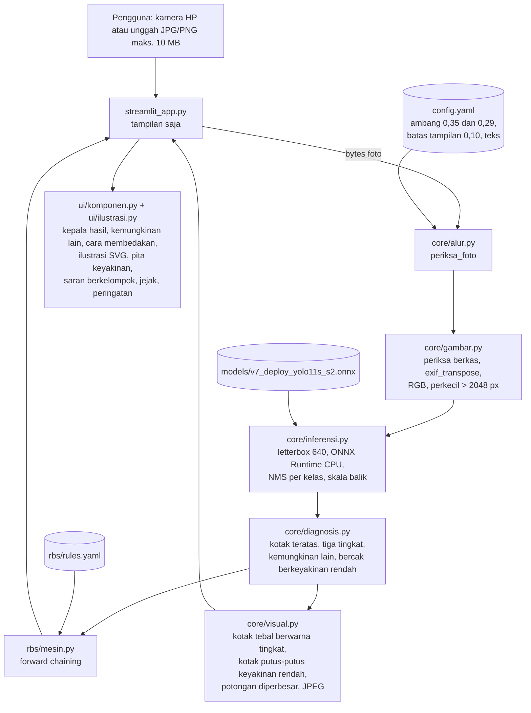
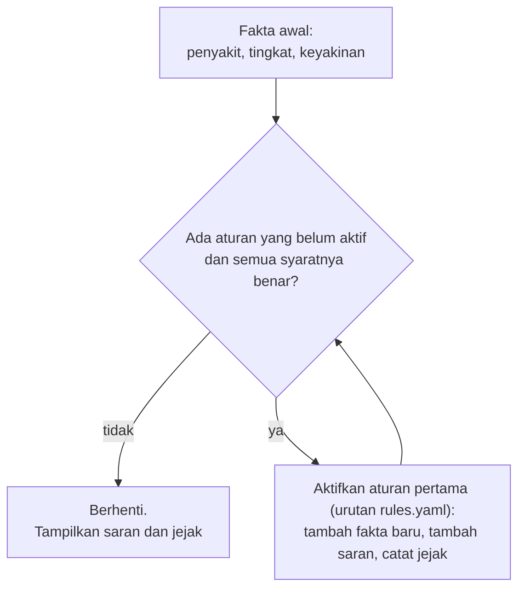

# Arsitektur

Tampilan (Streamlit) dipisahkan dari logika. `core/` dan `rbs/` tidak mengimpor Streamlit, sehingga bisa diuji dan dipakai ulang tanpa
antarmuka. `ui/komponen.py` hanya membuat string HTML.

## Penyampaian tambahan (tidak mengubah diagnosis, tingkat, atau saran)

| Fitur | Syarat (`core/diagnosis.py`) | Tampilan | Jejak |
|---|---|---|---|
| Kemungkinan lain | tingkat bukan "tidak terdeteksi"; ada kotak penyakit LAIN dengan keyakinan ≥ ambang rendah; satu, tertinggi | "Kemungkinan lain: <penyakit> (<keyakinan>%)" di bawah nama penyakit | fakta `kemungkinan_lain`, `keyakinan_kemungkinan_lain` + catatan tampilan |
| Cara membedakan | Blast atau Brown spot sebagai diagnosis atau kemungkinan lain | ilustrasi blas daun dan bercak cokelat berdampingan (ciri bab 2.2) + saran konfirmasi ke penyuluh | - |
| Bercak berkeyakinan rendah | tingkat "tidak terdeteksi"; kotak teratas ≥ `tampilan.batas_bercak_rendah` (0,10; batas tampilan, bukan ambang diagnosis) | kotak netral putus-putus berlabel "keyakinan rendah" + kalimat foto ulang/konfirmasi; saran tetap N02 | fakta `bercak_keyakinan_rendah` + catatan tampilan |

Fakta tambahan ikut masuk memori kerja, tetapi tidak ada aturan di `rules.yaml` yang memakainya, sehingga rantai aturan dan saran sama
persis dengan tanpa fitur ini (diuji di `tests/test_inti.py`).

## Alur forward chaining

Rantai yang terjadi (dua putaran, lalu berhenti):

| Tingkat | Putaran 1 | Fakta baru | Putaran 2 | Saran |
|---|---|---|---|---|
| terdeteksi | D01 Diagnosis diterima | `diagnosis = <penyakit>` | R001 / R002 / R003 | butir Tabel 3.1: tindakan sekarang [S] + pencegahan musim berikutnya [P] |
| kemungkinan | K01 Diagnosis belum pasti | `dugaan`, `perlu_konfirmasi = ya` | K02 | konfirmasi ke penyuluh + pencegahan umum |
| tidak terdeteksi | N01 Tidak ada penyakit yang dikenali | `perlu_foto_ulang = ya` | N02 | foto ulang + tanya penyuluh + pencegahan umum |

## Memori dan kecepatan

Diukur di folder proyek skripsi dengan Chrome headless (hasil: `docs/uji/sumber_daya.md`):
- RAM diam 145 MB, puncak 250 MB, dan 158 MB setelah 11 foto;
- waktu inti ±0,1 detik per foto di CPU laptop.

Penghemat memori:
- model dimuat sekali (`st.cache_resource`);
- arena memori ONNX Runtime dimatikan;
- foto > 2048 px didekode kecil;
- foto hasil dikirim sebagai JPEG.
